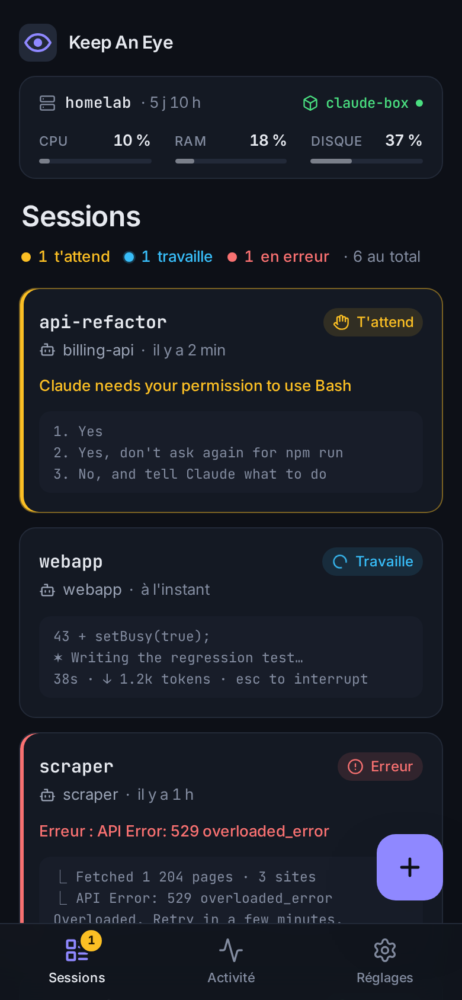
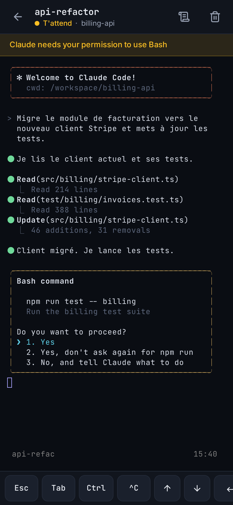
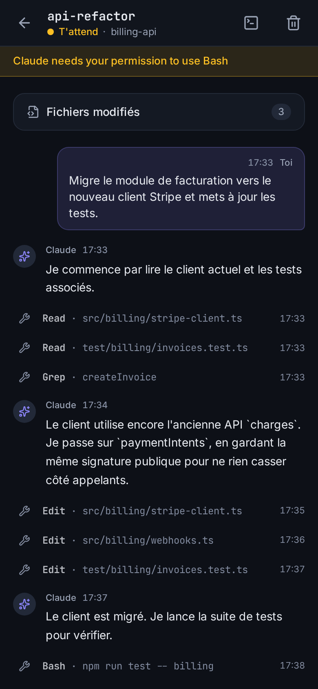
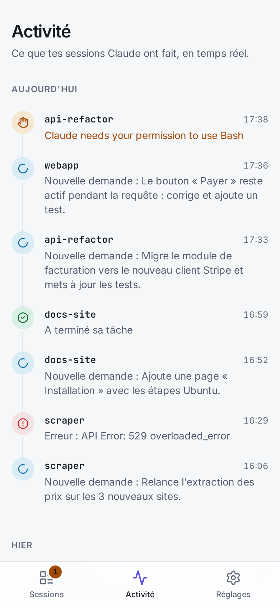
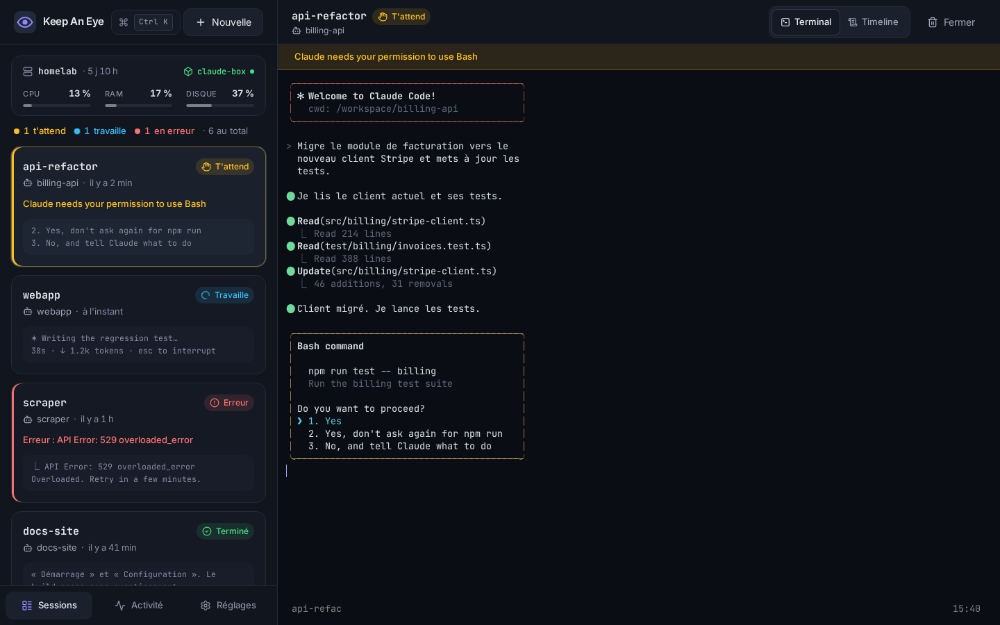
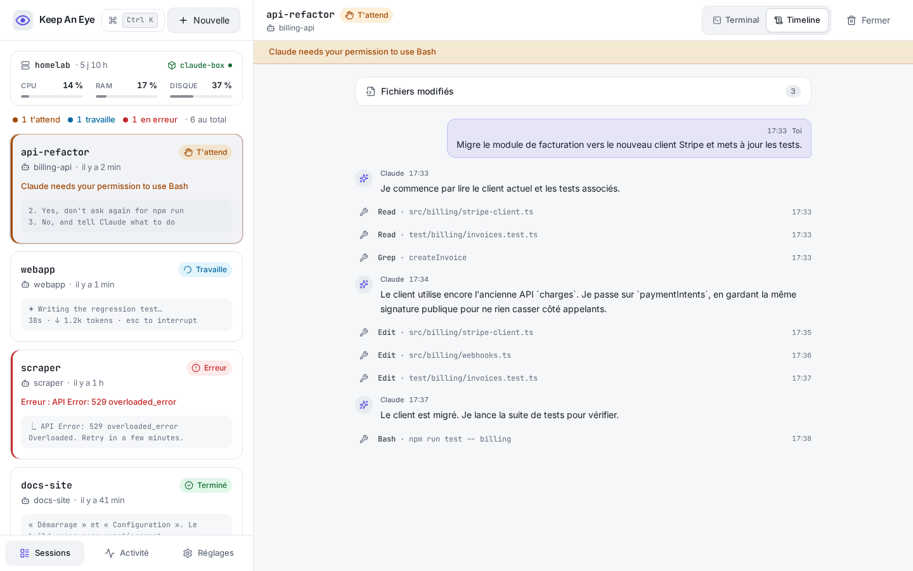

# Keep An Eye

Tour de contrôle de mes sessions **tmux** et **Claude Code** sur mon serveur maison : une PWA calme et précise qui dit en une seconde ce qui demande mon attention.

Créé par **Willem Vanbaelinghem**.

<p align="center">
  
  
  
  
</p>
<p align="center">
  
  
</p>

Toutes les captures (mobile et bureau, sombre et clair) sont dans [`docs/screenshots/`](docs/screenshots/).

## Ce que fait l'appli

- **Tableau de bord** : toutes les sessions tmux, leur type (terminal ou Claude), le projet, la dernière activité et un aperçu en direct des dernières lignes. Ce qui **t'attend** remonte en premier, puis ce qui travaille.
- **Statut Claude** par session : *T'attend* (ambre), *Travaille* (bleu, point qui pulse), *Terminé* (vert), *Erreur* (rouge), *Inactif* (gris) — toujours avec une icône et un libellé.
- **Terminal en direct** dans le navigateur (xterm.js ↔ WebSocket ↔ `tmux attach` dans un pty). Plusieurs appareils peuvent regarder la même session ; fermer l'onglet détache sans tuer la session. Reconnexion automatique, liens cliquables, copier-coller.
- **Mobile d'abord** : terminal plein écran qui se redimensionne au-dessus du clavier, barre de touches `Esc` `Tab` `Ctrl` `^C` `↑` `↓` `⏎` `←` `→` et coller.
- **Créer / fermer** des sessions à partir de modèles (Terminal, Claude dans claude-box, et les tiens).
- **Cloner un repo** au moment de lancer Claude : tape `propriétaire/repo` (ou colle l'URL GitHub) au lieu de choisir un projet ; l'appli lance `gh repo clone` dans claude-box (utilisateur `claude`, donc avec son authentification `gh`), le dossier arrive dans `~/claude-box/workspace` et rejoint la liste des projets. Si le dossier existe déjà, il est réutilisé tel quel.
- **Suivi de Claude Code** par des hooks qui écrivent dans un fichier (claude-box ne peut pas joindre l'appli), et **timeline** lisible du transcript : messages, outils, fichiers modifiés.
- **Notifications Web Push** quand une session t'attend, a terminé ou est en erreur ; toucher la notification ouvre la session. Réglages par type et plage « ne pas déranger ».
- **Bureau** : deux panneaux, palette de commandes `Ctrl K`, raccourcis (`?`).
- Bandeau d'état de l'hôte : CPU, RAM, disque et état du conteneur `claude-box`.

## Sécurité

L'appli donne un shell sur le serveur : elle est verrouillée même derrière Tailscale.

- Écoute **uniquement sur 127.0.0.1** (elle refuse de démarrer sur une autre adresse) ; exposée seulement à ton tailnet par `tailscale serve`.
- **Mono-utilisateur, deux facteurs** : mot de passe (argon2id) puis code TOTP (Google Authenticator, Aegis, 2FAS…), fenêtre ±30 s, **anti-rejeu**. 10 codes de secours hachés à usage unique. Compte créé **uniquement en CLI** (`npm run admin:init`) : aucune page d'inscription.
- Sessions côté serveur (SQLite, identifiant 256 bits stocké haché), cookie `HttpOnly; Secure; SameSite=Strict`, expiration après 12 h d'inactivité et 7 jours maximum, bouton « Tout déconnecter ».
- Blocage progressif des tentatives (par IP et global), réponses de connexion à durée constante.
- Vérification de l'en-tête `Origin` sur chaque requête qui modifie quelque chose et à chaque ouverture de WebSocket ; WebSocket refusé sans session valide.
- CSP stricte (aucun script inline), `frame-ancestors 'none'`, `Referrer-Policy: no-referrer`, etc. Aucune ressource externe : polices et code sont bundlés.
- tmux et Docker sont pilotés par `execFile` avec tableau d'arguments, jamais par un shell. Noms de session validés (`^[a-zA-Z0-9_-]{1,40}$`), projets vérifiés contre le contenu réel de `~/claude-box/workspace`.
- Tout ce qui vient de claude-box (événements, transcripts) est traité comme **non fiable** : taille limitée, parsing défensif, chemins vérifiés, rendu échappé.
- **Journal d'audit** consultable dans Réglages → Journal d'audit.

## Installation avec Docker (recommandé)

Plus besoin d'installer Node ni de compiler quoi que ce soit sur l'hôte : tout est dans l'image.

**Comment ça s'articule.** Le conteneur n'embarque qu'un *client* tmux. Il se connecte au serveur tmux de l'hôte par son socket (`/tmp/tmux-<uid>`). Tes terminaux et tes sessions Claude tournent donc sur l'hôte, comme avant, et survivent à l'arrêt ou à la mise à jour du conteneur. Le conteneur :

- utilise le **réseau de l'hôte** et écoute sur `127.0.0.1:7777` (rien n'est publié ailleurs) ;
- tourne avec **ton UID** (sinon tmux refuse la connexion) ;
- voit `~/claude-box` **au même chemin** que sur l'hôte ;
- accède au socket Docker pour afficher l'état de claude-box.

### 1. Prérequis

- Docker Engine avec le plugin compose. Ton utilisateur doit être dans le groupe `docker`.
- tmux sur l'hôte : `sudo apt-get install -y tmux git`.
- Tailscale.

### 2. Récupérer et préparer

```bash
git clone https://github.com/Whiplashhhh/KeepAnEye.git ~/keep-an-eye
cd ~/keep-an-eye
./scripts/docker-init.sh
sudo loginctl enable-linger "$USER"     # pour que tmux et l'appli tournent sans session ouverte
nano .env                               # KAE_ALLOWED_ORIGINS=https://<machine>.<tailnet>.ts.net
```

`docker-init.sh` fait trois choses :

- il crée `.env` et y écrit ton UID/GID, ton dossier personnel, le GID du groupe `docker` et ton fuseau horaire ;
- il crée `data/` ;
- il active `tmux-server.service`, un serveur tmux permanent sur l'hôte (option `exit-empty off`). Le conteneur ne démarre jamais tmux lui-même : sinon les sessions vivraient dans le conteneur et mourraient avec lui. Tes `tmux attach` habituels se rattachent au même serveur.

### 3. Démarrer et créer le compte

```bash
docker compose up -d --build
docker compose exec keep-an-eye npm run admin:init
docker compose ps                        # état « healthy »
curl -s http://127.0.0.1:7777/api/health # {"ok":true}
```

`restart: unless-stopped` relance l'appli au démarrage de la machine.

### 4. Tailscale et PWA

Comme sans Docker : voir les étapes [6](#6-exposer-sur-le-tailnet-avec-tailscale-serve) et [7](#7-installer-la-pwa) ci-dessous. `tailscale serve` pointe toujours vers `http://127.0.0.1:7777`.

### Commandes utiles

| Action | Commande |
|---|---|
| Journaux | `docker compose logs -f` |
| Mettre à jour | `git pull && docker compose up -d --build` |
| Redémarrer | `docker compose restart` (les sessions tmux ne bougent pas) |
| Réinitialiser la 2FA | `docker compose exec keep-an-eye npm run admin:reset-2fa` |
| Nouveau mot de passe | `docker compose exec keep-an-eye npm run admin:reset-password` |
| Modèles personnalisés | décommente la ligne `config/templates.json` dans `compose.yml` |

La base est dans `./data` : la section [Sauvegarde](#sauvegarde-de-la-base) s'applique telle quelle (préfixe les commandes `node` par `docker compose exec keep-an-eye`, ou arrête le conteneur et copie `data/keep-an-eye.db`).

## Installation sans Docker (Ubuntu)

Les commandes ci-dessous supposent que l'appli vit dans `~/keep-an-eye` et que tu es connecté avec ton utilisateur habituel (celui qui lance tmux et Docker).

### 1. Prérequis

```bash
# Node.js 22 (NodeSource ; nvm fonctionne aussi)
curl -fsSL https://deb.nodesource.com/setup_22.x | sudo -E bash -
sudo apt-get install -y nodejs
# Outils de compilation pour node-pty, et tmux
sudo apt-get install -y build-essential python3 tmux git
node -v   # v22.x
```

Ton utilisateur doit pouvoir lancer `docker compose` sans `sudo` (groupe `docker`) pour que l'appli affiche l'état de claude-box et lance Claude.

### 2. Récupérer et construire

```bash
git clone https://github.com/Whiplashhhh/KeepAnEye.git ~/keep-an-eye
cd ~/keep-an-eye
npm ci
npm run build
```

### 3. Configurer

```bash
cp .env.example .env
nano .env
```

Le seul réglage indispensable est **`KAE_ALLOWED_ORIGINS`** : l'URL exacte sous laquelle Tailscale servira l'appli, par exemple `https://homelab.tail1234.ts.net` (le nom figure dans `tailscale status` ou dans la console Tailscale, rubrique *DNS*). Tous les réglages sont documentés dans [`.env.example`](.env.example).

### 4. Créer le compte (CLI uniquement)

```bash
npm run admin:init
```

La commande demande un mot de passe (12 caractères minimum, deux fois), affiche un **QR code** dans le terminal (et l'URI `otpauth://` si tu préfères la saisir), demande un premier code pour valider, puis affiche **10 codes de secours** : garde-les hors ligne, ils ne seront plus affichés.

### 5. Service systemd utilisateur

```bash
mkdir -p ~/.config/systemd/user
cp deploy/keep-an-eye.service ~/.config/systemd/user/
# Si node n'est pas /usr/bin/node (nvm…) ou si l'appli est ailleurs : adapte ExecStart et WorkingDirectory
systemctl --user daemon-reload
systemctl --user enable --now keep-an-eye
sudo loginctl enable-linger "$USER"     # pour qu'il tourne même sans session ouverte
systemctl --user status keep-an-eye
curl -s http://127.0.0.1:7777/api/health   # {"ok":true}
```

L'unité utilise `KillMode=process` : si l'appli a démarré le serveur tmux, un redémarrage de l'appli ne tue **pas** tes sessions.

### 6. Exposer sur le tailnet avec `tailscale serve`

```bash
sudo tailscale serve --bg --https=443 http://127.0.0.1:7777
tailscale serve status
```

L'appli est alors disponible en HTTPS sur `https://<machine>.<tailnet>.ts.net`, visible **uniquement** depuis tes appareils Tailscale. N'utilise jamais `tailscale funnel` (qui l'exposerait sur Internet). Pour arrêter : `sudo tailscale serve --https=443 off`.

### 7. Installer la PWA

- **Android (Chrome)** : ouvre l'URL, menu ⋮ → *Installer l'application*.
- **iPhone (Safari)** : ouvre l'URL, bouton Partager → *Sur l'écran d'accueil*. Les notifications push sur iOS demandent iOS 16.4+ et l'appli installée sur l'écran d'accueil.
- **PC** : icône d'installation dans la barre d'adresse de Chrome/Edge.

Puis Réglages → Notifications → **Activer** sur chaque appareil qui doit être prévenu, et **Envoyer** pour tester.

## claude-box : suivi de Claude Code

Les sessions Claude tournent dans le conteneur, qui ne peut pas joindre l'appli. Elles communiquent par **fichiers** : les hooks écrivent les événements dans `/events/claude.jsonl`, l'appli les lit côté hôte dans `~/claude-box/events/claude.jsonl`, et lit en lecture seule les transcripts dans `~/claude-box/claude-home/.claude/projects/`.

### 1. Modifier `~/claude-box/compose.yml`

Deux changements dans le service `claude` :

```yaml
services:
  claude:
    # … le reste ne change pas
    volumes:
      - ./workspace:/workspace
      - ./claude-home:/home/claude   # avant : claude-home:/home/claude (volume nommé)
      - ./events:/events             # nouveau : événements des hooks

# volumes:
#   claude-home:                     # à retirer s'il n'est plus utilisé ailleurs
```

- `./events:/events` : le dossier où les hooks déposent leurs événements.
- `./claude-home:/home/claude` en **bind mount** à la place du volume nommé : les transcripts deviennent lisibles depuis l'hôte (timeline). Si tu ne veux pas de timeline, garde le volume nommé : les statuts fonctionnent quand même.

Migrer le contenu du volume nommé existant (connexion Claude, réglages, historique) avant de redémarrer :

```bash
cd ~/claude-box
docker compose stop claude
mkdir -p claude-home events
docker volume ls | grep claude-home          # en général : claude-box_claude-home
docker run --rm -v claude-box_claude-home:/from -v "$PWD/claude-home":/to alpine sh -c 'cp -a /from/. /to/'
docker compose up -d claude
```

Les dossiers `events/` et `claude-home/` doivent être accessibles en écriture par l'utilisateur `claude` du conteneur et en lecture par ton utilisateur sur l'hôte (c'est le cas si les UID correspondent, en général 1000 ; sinon `chmod 1777 events`). L'appli fait elle-même la rotation de `claude.jsonl` au-delà de 5 Mo.

### 2. Installer les hooks dans le conteneur

Le script [`scripts/install-claude-hooks.sh`](scripts/install-claude-hooks.sh) ajoute des hooks `SessionStart`, `UserPromptSubmit`, `PreToolUse`, `Stop`, `Notification` et `SessionEnd` à `~/.claude/settings.json` **sans toucher à tes autres réglages** (sauvegarde faite à côté, installation idempotente). Il a besoin de `jq` dans le conteneur.

```bash
cp ~/keep-an-eye/scripts/install-claude-hooks.sh ~/claude-box/workspace/
cd ~/claude-box
docker compose exec -u claude claude bash /workspace/install-claude-hooks.sh
rm ~/claude-box/workspace/install-claude-hooks.sh
```

Chaque événement ajoute une ligne JSON compacte dans `/events/claude.jsonl`, enrichie de `$KEEP_AN_EYE_SESSION` (que l'appli passe à `docker compose exec -e`). Seuls les champs utiles sont gardés et tronqués : le contenu des fichiers écrits par Claude n'atterrit jamais dans les événements. Le hook ne bloque jamais Claude et n'écrit rien sur sa sortie. Pour retirer : `… install-claude-hooks.sh --uninstall`.

Relance les sessions Claude déjà ouvertes pour qu'elles prennent les hooks en compte.

### Comment les statuts sont déduits

| Événement | Statut |
|---|---|
| `UserPromptSubmit`, `PreToolUse` | Travaille |
| `Notification` (permission, question) | T'attend |
| `Stop` | Terminé (la notification « inactif » qui suit 60 s plus tard ne le change pas) |
| `StopFailure`, ou processus arrêté avec un code d'erreur | Erreur |
| `SessionStart`, `SessionEnd` | Inactif |

## Modèles de session

Les modèles sont dans [`config/templates.json`](config/templates.json) (ou le fichier pointé par `KAE_TEMPLATES_FILE`) et sont relus à chaque ouverture de la feuille « Nouvelle session ». La commande est un **tableau d'arguments** (jamais interprété par un shell) avec des jetons remplacés après validation :

| Jeton | Valeur |
|---|---|
| `{session}` | nom de la session (validé) |
| `{project}` | projet choisi (vérifié dans `~/claude-box/workspace`) |
| `{claudeBoxDir}`, `{workspaceDir}`, `{home}` | chemins configurés |
| `"{flags}"` | arguments des options cochées (par ex. `--dangerously-skip-permissions` pour « Autonome ») |

Exemple de modèle supplémentaire :

```json
{
  "id": "htop",
  "label": "Moniteur",
  "description": "htop sur l'hôte",
  "kind": "terminal",
  "command": ["htop"]
}
```

## Utilisation

| Raccourci | Action |
|---|---|
| `Ctrl K` | Palette de commandes (`Ctrl Shift K` depuis le terminal) |
| `N` | Nouvelle session |
| `J` / `K` | Session suivante / précédente |
| `G` puis `A` / `R` | Activité / Réglages |
| `T` | Basculer le thème |
| `Ctrl Shift C` / `Ctrl Shift V` | Copier / coller dans le terminal |
| `?` | Aide des raccourcis |

Le titre de l'onglet et le favicon affichent le nombre de sessions qui t'attendent.

## Mise à jour

```bash
cd ~/keep-an-eye
git pull
npm ci
npm run build
systemctl --user restart keep-an-eye
```

Les migrations de la base sont appliquées automatiquement au démarrage. Redémarrer l'appli ne touche pas aux sessions tmux.

## Sauvegarde de la base

Tout l'état de l'appli (compte, sessions de connexion, journal d'audit, abonnements push, réglages) est dans `data/keep-an-eye.db`. Sauvegarde à chaud, cohérente :

```bash
cd ~/keep-an-eye
node -e "require('better-sqlite3')('data/keep-an-eye.db').backup('data/backup-' + new Date().toISOString().slice(0,10) + '.db').then(() => console.log('ok'))"
# ou, avec le paquet sqlite3 : sqlite3 data/keep-an-eye.db ".backup 'data/backup.db'"
```

Pour restaurer : arrête le service, remplace `data/keep-an-eye.db` par la sauvegarde (et supprime les fichiers `-wal`/`-shm` éventuels), redémarre. Les clés VAPID étant dans la base, les abonnements push restent valides après restauration.

## Dépannage

| Symptôme | Piste |
|---|---|
| « Origine de la requête non autorisée » à la connexion | `KAE_ALLOWED_ORIGINS` doit être exactement l'URL affichée dans la barre d'adresse (`https://…ts.net`, sans `/` final), puis `systemctl --user restart keep-an-eye`. |
| « Aucun compte n'est encore configuré » | Lance `npm run admin:init` sur le serveur. |
| Code TOTP toujours refusé | Vérifie l'heure du serveur (`timedatectl`) et du téléphone. Un même code ne peut servir qu'une fois : attends le suivant. En dernier recours : `npm run admin:reset-2fa`. |
| Mot de passe oublié | `npm run admin:reset-password` (ferme toutes les sessions ouvertes). |
| « Trop de tentatives » | Blocage temporaire après des échecs ; il se lève seul. Un redémarrage du service le remet à zéro. |
| Aucune session listée alors que tmux tourne | L'appli doit tourner sous le **même utilisateur** que tmux. Si tu utilises un socket nommé (`tmux -L xxx`), mets-le dans `KAE_TMUX_SOCKET`. |
| Les sessions Claude restent « Inactif » (sans hooks, l'appli lit l'écran de Claude et déduit Travaille / T'attend / Terminé ; « Erreur » ne vient que d'un processus mort ou du hook `StopFailure`) | Volume `./events:/events` présent ? Hooks installés (`jq` dans le conteneur) ? Session relancée après l'installation ? `tail -f ~/claude-box/events/claude.jsonl` doit bouger quand Claude travaille. |
| Timeline vide | Le bind mount `./claude-home:/home/claude` est nécessaire, et ton utilisateur doit pouvoir lire `~/claude-box/claude-home/.claude/projects`. |
| claude-box affiché en gris | `docker compose ps` doit fonctionner sans sudo pour ton utilisateur (groupe `docker`), et `KAE_CLAUDE_BOX_DIR` pointer vers le dossier du `compose.yml`. |
| Pas de notifications | Appli installée (obligatoire sur iOS), notifications autorisées pour le site, « Activer » cliqué sur cet appareil, plage « ne pas déranger » désactivée. Bouton **Envoyer** pour tester. |
| Page blanche après une mise à jour | `npm run build` puis redémarre le service (les fichiers statiques sont indexés au démarrage). Avec Docker, `docker compose up -d --build` s'en charge. |
| Journaux | `journalctl --user -u keep-an-eye -f` (Docker : `docker compose logs -f`) |
| Docker : le conteneur ne démarre pas, « bind source path does not exist » | Le socket tmux `/tmp/tmux-<uid>` ou `~/claude-box` est absent. Lance `systemctl --user start tmux-server` (ou `./scripts/docker-init.sh`), puis `docker compose up -d`. |
| Docker : « Le serveur tmux de l'hôte ne tourne pas » | `systemctl --user enable --now tmux-server` et `sudo loginctl enable-linger $USER`. |
| Docker : « protocol version mismatch » dans les journaux | Le tmux de l'hôte est trop ancien ou trop récent par rapport à celui de l'image (Debian 12, tmux 3.3). Tout tmux 3.x convient. |
| Docker : claude-box en gris | `DOCKER_GID` dans `.env` doit être le GID du groupe `docker` (`getent group docker`), puis `docker compose up -d`. |

## Développement

```bash
npm ci
cp .env.example .env    # KAE_ALLOWED_ORIGINS=http://localhost:5173 pour le serveur de dev Vite
npm run dev             # API sur :7777, interface Vite sur :5173 (proxy /api et /ws)
npm run lint && npm run typecheck && npm test
npm run build && npm run e2e         # tests Playwright (tmux réel sur un socket dédié)
npm run screenshots                  # captures mobile + bureau, sombre + clair → docs/screenshots/
```

- `apps/server` : Fastify, `ws`, `node-pty`, `better-sqlite3`, `zod`.
- `apps/web` : React, Vite, Tailwind CSS, xterm.js, `lucide-react`, Radix Dialog.
- `packages/shared` : schémas et types partagés.

Architecture, modèle de données, API et messages WebSocket : [`docs/PLAN.md`](docs/PLAN.md). Choix faits en route : [`docs/DECISIONS.md`](docs/DECISIONS.md).

---

Keep An Eye est créé par **Willem Vanbaelinghem** — © 2026. Sous licence [MIT](LICENSE).
